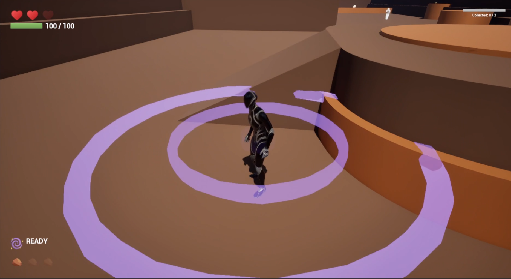
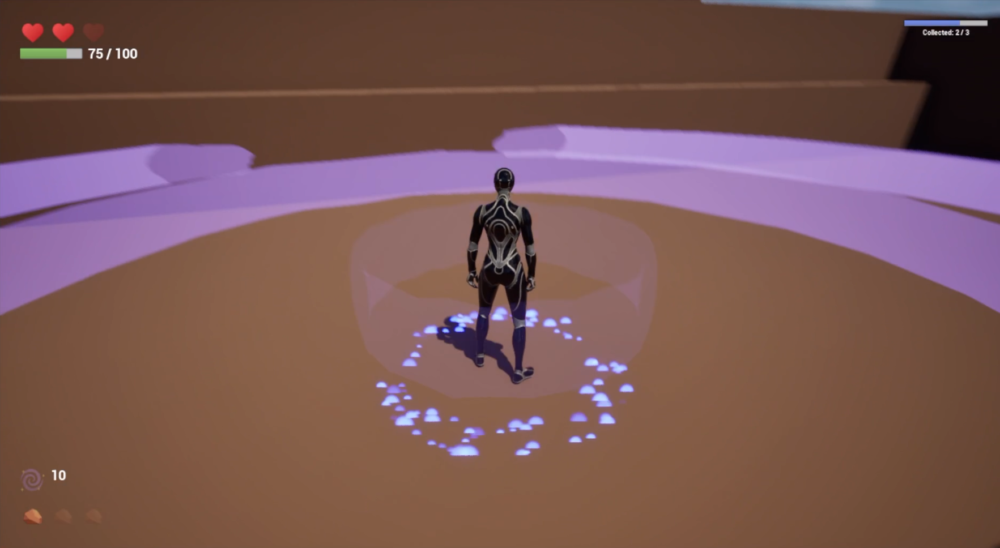
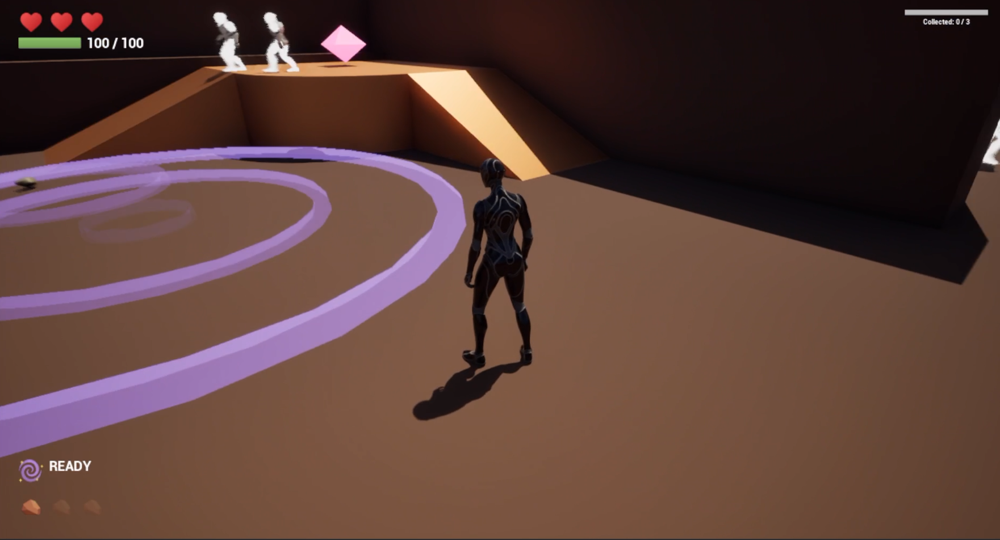

# Hush & Blink
### A Sound-Based Stealth Game | Unreal Engine 5

*They can't see you. But they can hear you disappear.*

What if being invisible wasn't enough to stay hidden?

**Hush & Blink** is a third-person stealth prototype built around a simple idea: enemies are blind, but they can hear you. Every movement has consequences, and escaping danger isn't always as easy as running away.

The player can teleport across the environment, reaching new positions almost instantly. But teleportation comes at a cost: it produces a loud noise that can attract nearby enemies. Walking carefully, choosing when to teleport, and creating distractions become essential to staying alive.

The goal is to collect the required objectives without being caught, using the environment and the enemies' reliance on sound to your advantage.

## Gameplay & Interaction

The gameplay revolves around balancing mobility and stealth. Different actions generate sounds with different detection ranges, from quieter footsteps to loud teleportation events.

Enemies patrol the level and investigate sounds they detect. Rather than knowing the player's position at all times, they move toward the **last location where a sound was heard**. This makes it possible to mislead them: a carefully timed teleport or a thrown object can draw their attention away from the player's actual position.

The main mechanics include:

- **Teleportation** with destination validation, visual targeting feedback, and a cooldown.
- **Sound-based detection**, where movement and interactions generate noise events with different ranges.
- **Blind enemy AI** that patrols, investigates sounds, and attacks at close range.
- **Throwable distractions** that can be collected and used to redirect enemies.
- **Collectible objectives**, health, lives, and respawning, with a HUD showing the player's progress and available resources.

## Technical Implementation

The project was developed primarily in **C++**, with Blueprints used to configure gameplay properties and integrate components within Unreal Engine.

One of the main challenges was building a sound system that could connect different gameplay mechanics without implementing the same logic repeatedly.

To achieve this, I developed a reusable **`NoiseEmitter` Actor Component**, which can be attached to different actors, including the player, throwable objects, and collectibles. Noise events have configurable properties such as detection radius, cooldown, tag, audio cue, and visual effect.

Sound propagation is represented through expanding **Niagara effects**, providing visual feedback for a mechanic that would otherwise be invisible.

Enemy behaviour is implemented using **AI Perception (Hearing)**, AI Controllers, Blackboards, Behaviour Trees, and NavMesh navigation. When an enemy detects a noise, its Blackboard is updated with the sound location, allowing it to investigate independently of the player's current position. The attack system handles distance checks, damage, cooldowns, and knockback.

The teleportation system uses camera-based line tracing to identify valid destinations and combines gameplay logic with visual feedback and cooldown management.

Other systems include Enhanced Input, physics-based throwables, objective tracking, health and respawning, and UMG widgets for gameplay information.

## Gameplay Demo

**[▶ Watch Demo](https://drive.google.com/file/d/1-C_LuQC4ZuhCJljYioR8shz564pbpjk5/view?usp=sharing)**

The video shows the main gameplay mechanics, including sound visualization, enemy reactions, teleportation, objective collection, and win/loss conditions.

## Development Notes

Hush & Blink was developed as an individual project for the **Games Programming** unit at **Monash University (2026)**.

The main focus was on designing and implementing interconnected gameplay systems in C++, particularly the interaction between sound generation, enemy perception, and player movement.

The result is a functional prototype rather than a finished game. While the core mechanics are implemented, enemy movement and reactions would benefit from further tuning, and clearer animations and feedback would make their behaviour easier to interpret. The level design and overall visual presentation also remain intentionally simple.

Further development would focus on refining enemy responsiveness, improving visual feedback for investigation and attacks, and creating a more engaging environment around the existing stealth mechanics.

## Tools & Technologies

- **Engine:** Unreal Engine 5
- **Programming:** C++, Blueprints
- **AI:** AI Perception, Behavior Trees, Blackboards, NavMesh
- **Gameplay & Visuals:** Enhanced Input, Niagara, UMG, Unreal Physics